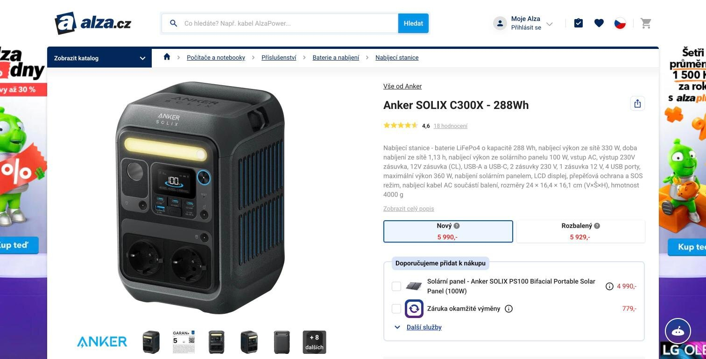
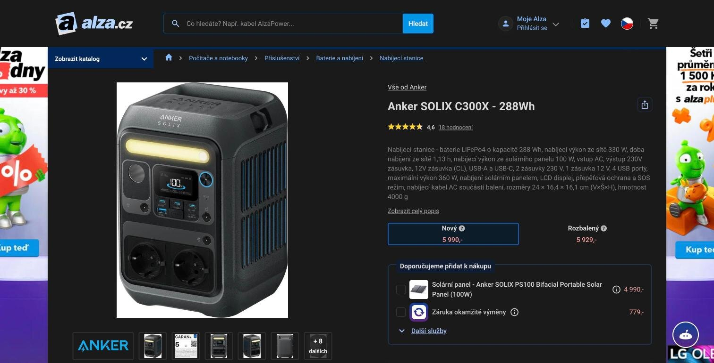
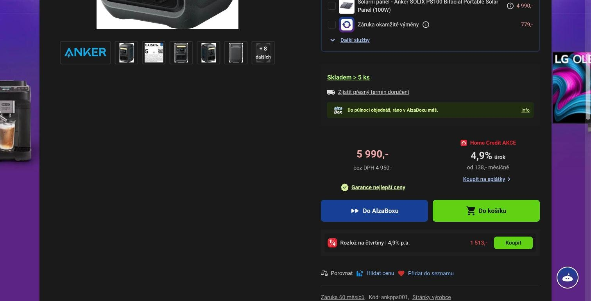
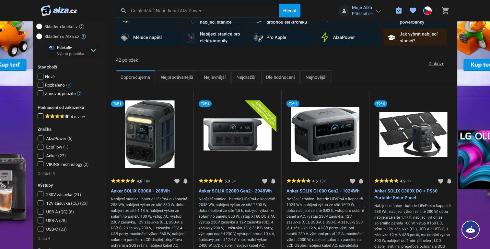

# Alza Dark Mode

Userscript that adds a dark mode to Alza.cz and Alza.sk. It turns on only when the system uses dark appearance, so Alza follows the rest of your Mac, PC or phone.

| Original | Dark mode |
| --- | --- |
|  |  |

## Install

1. Install a userscript manager for your browser:
   - **Safari** (Mac, iPhone, iPad): [Userscripts](https://apps.apple.com/app/userscripts/id1463298887). Turn the extension on in Safari → Settings → Extensions and allow it on alza.cz (and alza.sk).
   - **Chrome, Edge, Brave**: [Tampermonkey](https://www.tampermonkey.net/) or [Violentmonkey](https://violentmonkey.github.io/). In Chrome, also open the extension's details (`chrome://extensions`) and turn on **Allow user scripts**, otherwise no script runs.
   - **Firefox**: [Tampermonkey](https://www.tampermonkey.net/) or [Violentmonkey](https://violentmonkey.github.io/).
2. Open the script:

   https://raw.githubusercontent.com/kasparek-net/alza-dark-mode/main/alza-dark.user.js

3. Confirm the installation in the dialog your userscript manager shows. In Safari Userscripts, open the extension's popup on that page and click **Install**.
4. Reload any open Alza tab.

## Use

- Switch the system to dark appearance (macOS: System Settings → Appearance, Windows: Settings → Personalization → Colors, iOS: Settings → Display & Brightness). Alza turns dark; switching back to light reloads the page in its original colors.
- To keep Alza light while the system is dark, disable the script in your userscript manager.

## Update

Tampermonkey and Violentmonkey check for new versions automatically. To update right away, open the install link above again. In Safari Userscripts, reinstall from the link.

## How it works

Alza has no dark theme, so the script recolors the page after it loads: light backgrounds and borders become dark, dark text and icons become light, and hues are kept so links, prices and badges stay recognizable. Product photos are left untouched. Content that loads later (filters, infinite scrolling, pop-ups) is recolored as it appears.

## Known limitations

- A short flash of the light page can appear before the script recolors it.
- Some images with a white background (product photos, banners) stay white on purpose.
- If something is unreadable, open an issue with a screenshot and the page URL.

## Uninstall

Remove **Alza Dark Mode** in your userscript manager's dashboard.
